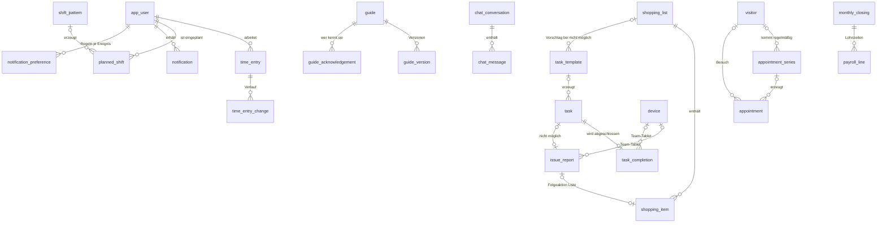

# Konzept 6 – Datenbank (MariaDB 11.4 LTS)

Stand: 01.11.2026 (nachmittags) · Referenzschema: `docs/datenbank/schema.sql` · Test: `docs/datenbank/smoke_test.sql` · App: **HomeCrew**

## 1. Rahmen
- **MariaDB 11.4 LTS** (geklärt), InnoDB, `utf8mb4_unicode_ci`.
- **Eine Datenbank = ein Haushalt** – keine Mandantenspalten (geklärt).
- **78 Tabellen**, 154 Fremdschlüssel, 155 CHECK-Constraints (statisch geprüft).
- Später erzeugen Doctrine-Migrations das Schema; `schema.sql` ist die fachliche Referenz.

## 2. Konventionen
| Thema | Regel |
|---|---|
| Namen | Tabellen/Spalten englisch, snake_case; Wertelisten deutsch |
| Schlüssel | `BIGINT UNSIGNED AUTO_INCREMENT`; nach außen sichtbare Objekte zusätzlich `public_id BINARY(16)` (UUID v7) |
| Zeit | Zeitpunkte in **UTC** (technische Zeitstempel, Stempelzeiten); **Geplantes** in Ortszeit |
| Zahlen | Geld `DECIMAL(10,2)`, Prozentsätze `DECIMAL(6,3)`, Dauern in Minuten |
| Wertelisten | `VARCHAR` + `CHECK` (PHP-Backed-Enums) |
| Verschlüsselung | Spalten `*_enc` = libsodium-Chiffrat (u. a. KI-Schlüssel, SMTP-Passwort) |
| NULL in CHECKs | Optionale Spalten immer mit `IS [NOT] NULL`; keine CHECKs auf Spalten mit `ON DELETE SET NULL` |
| Serien | Vorlage + erzeugte Vorkommen mit **Ursprungstag** (eindeutig je Vorlage und Tag) und `is_modified` – gleiches Muster bei Wartungsplänen, Dienstplan und Termin-/Besuchsserien |

## 3. Tabellen nach Bereichen

| Bereich | Tabellen | Stufe |
|---|---|---|
| Einstellungen & Erweiterungen | `app_setting` (genau eine Zeile – inkl. KI-Schlüssel, SMTP-Zugang, Status, Funktionsschalter) | 1 |
| Personen, Anmeldung, Geräte | `app_user`, `webauthn_credential`, `password_reset_request`, `invitation`, `device` | 1 |
| Alltag | `task_template`, `task_template_item`, `task`, `task_item`, `task_completion`, `task_item_result`, `handover_note`, `handover_read` | 1 |
| Kalender: Termine & Besuche | `visitor` (externe Dienste), `appointment_series`, `appointment`, `appointment_participant`, `appointment_item` | 1 |
| Listen | `shopping_list`, `shopping_item`, `shopping_favorite` | 1 |
| Meldungen | `issue_report` | 1 |
| Dienstplan & Zeiten | `shift_pattern`, `planned_shift`, `time_entry`, `time_entry_change`, `manager_absence` | 1 |
| Wissen & Notfall | `guide`, `guide_version`, `guide_step`, `guide_step_media`, `guide_tag`, `guide_feedback`, `guide_acknowledgement`, `recipe_ingredient`, `emergency_contact` | 1 |
| Orte, Profil | `poi`, `poi_guide`, `profile_item`, `profile_keyword` | 1 |
| Medien | `media`, `upload_session` | 1 |
| Benachrichtigungen, Protokoll | `notification`, `notification_preference`, `audit_log` | 1 |
| Nachrichten | `chat_conversation`, `chat_message`, `chat_participant` | 2 |
| Hilfsmittel & Wartung | `asset`, `asset_component`, `asset_component_property`, `asset_guide`, `component_measurement` | 2 (Tabellen schon in 1) |
| KI-Assistent | `ai_conversation`, `ai_message`, `ai_action`, `ai_usage_month` | 2 |
| Personal & Abrechnung | `employee_record`, `wage_rate`, `vacation_entitlement`, `absence`, `sick_pay_refund`, `monthly_closing`, `timesheet_confirmation`, `payroll_line`, `funding_grant`, `reminder` | 3 (Urlaubsantrag/Krank schon in 1) |
| Checklisten | `checklist_template`, `checklist_template_item`, `checklist`, `checklist_item` | 3 |
| Global | `legal_limit`, `contribution_rate` | 3 |
| Push, Kalender-Abo | `push_subscription`, `calendar_feed` | 4 |
| Übersetzung | `guide_translation`, `guide_step_translation` | 5 |

**Entfallen** (geklärt): Mandanten, Lernpfade, Schlüsselliste (zurückgestellt), gemeinsamer Entsperr-Code am Tablet, `task_completion.follow_up` (→ Meldung).

## 4. Kern-Beziehungen



## 5. Wichtige Entscheidungen
1. **`app_user` = Person im Haushalt** inkl. Anmeldung (Passwort/Passkey/2FA und/oder Tablet-PIN) und persönlicher Einstellungen. Benutzername vom Admin, eindeutig; Anzeigename eindeutig. Personen ohne jeden Zugang (nur Team-Tablet) sind erlaubt. **Externe Dienste sind keine `app_user`**, sondern `visitor`.
2. **Rolle + Admin-Recht**: `role` (manager/assistenz/angehoerige), `is_admin`. CHECKs: Manager ist immer Admin, Assistenz nie Admin; **genau ein Manager** (generierte Spalte + eindeutiger Index). 2FA-Pflicht für Admins setzt die App beim Login durch.
3. **PIN** pro Person, Standard aus; nur mit gesetzter PIN aktivierbar; Start-PIN muss geändert werden; `app_setting.pin_lan_only`.
4. **Gerätemodus** (`device.mode`): `team` (Standard) · `persoenlich` · `beides`; Bildschirmschoner (`dim_after_seconds`). Kein eigener Entsperr-Code.
5. **Absender Gerät statt Person**: `task_completion`, `issue_report`, `handover_note`, `shopping_item`, `media` und `audit_log` haben eine Geräte-Spalte (ON DELETE SET NULL).
6. **Erweiterungen in `app_setting`**: KI (`ai_enabled`, Anbieter, Modell, `ai_api_key_enc` + `ai_api_key_hint`, `ai_key_status` fehlt/ungeprueft/ok/fehler, Prüfzeitpunkt, Fehlermeldung, Funktionsschalter Assistent/Schreibhilfe/Übersetzung/Team-Tablet, Monatsbudget) und E-Mail (`mail_enabled`, SMTP-Server/Port/Verschlüsselung/Benutzer, `smtp_password_enc`, Absender, `mail_status`). CHECKs: **KI nur mit Schlüssel einschaltbar**; Status „fehlt" genau dann, wenn kein Schlüssel; **E-Mail nur mit Server, Port und Absender einschaltbar**. Ob eine Funktion sichtbar ist, entscheidet die App zur Laufzeit (`FeatureAvailability`: Schalter + Status ok + Budget + Personenrecht).
7. **Besuche & Serien**: `appointment.kind` = `termin` · `besuch`. Besuche haben weder Begleitung noch Zuständigkeits-Rolle (CHECK, auch an der Serie); Standard-Sichtbarkeit `alle`. `appointment_series` erzeugt Vorkommen mit `occurrence_date` (eindeutig je Serie) und `is_modified`; `status = abgesagt` mit `cancel_note`. Serie löschen entfernt ihre Vorkommen (CASCADE).
8. **Meldungen** (`issue_report`): genau eine je Aufgabe bei „nicht möglich" oder über „Melden"; Status mit Abschluss-CHECKs; Folgeaktion mit Verweis; automatischer Abschluss durch die App; „auch bemerkt".
9. **Benachrichtigungsregeln** (`notification_preference`): je Person und Ereignis App/E-Mail/Push; nur Abweichungen von den Standards je Rolle.
10. **„Zuletzt erledigt"**: für alle nur das Datum; Admins sehen zusätzlich Person bzw. Gerät.
11. **Zeitänderungen**: `time_entry_change` protokolliert jede Änderung; `selbst` ohne, `admin`/`nachtrag` mit Begründung (CHECK). „Dienstplan übernehmen" → `start_source = 'dienstplan'`.
12. **Zuständigkeit & Weitergeben** an Aufgaben, Terminen und Checklisten-Punkten; `assigned_by_user_id`/`assigned_at`.
13. **Sichtbarkeit** einheitlich: `alle` · `zustaendig` · `admins` · `privat`; Meldungen `alle` · `admins`. Das Team-Tablet sieht, was die Rolle Assistenz sähe.
14. **Mehrere Listen**; Listeneinträge mit Quelle (`manuell`, `aufgabe`, `rezept`, `ki`, `meldung`).
15. **Notfallkontakte**, **Wer kennt welche Anleitung**, ein offener Dienst je Person, versionierte Anleitungen, bezahlte Ausfälle mit Rechen-CHECKs, Medien mit genau einem Besitzer, ein Team-Chat, ein Direktchat je Paar.
16. **Datenschutz in der Struktur**: keine Diagnosen, Medikamente, Adressen, SV-/Steuernummern; externe Dienste ohne Klarnamen; Geheimnisse nur verschlüsselt; Löschdaten an allen kurzlebigen Inhalten.

## 6. Hinweise für Doctrine
- CHECK-Constraints und generierte Spalten in den Migrations von Hand pflegen; nie `doctrine:schema:update`.
- Generierte Spalten nicht bzw. nur lesend mappen.
- `app_user` als Symfony-User-Entity (Benutzername als Identifier); PIN-Anmeldung als eigener Authenticator, nur für gekoppelte Geräte im Heimnetz.
- **Team-Tablet** als eigener Security-Kontext: Geräte-Token (Cookie) → „Geräte-Benutzer" mit Rolle `ROLE_TEAM_DEVICE`, kein `app_user`.
- **Erweiterungen**: `*_enc`-Felder nie in Formulare zurückschreiben (nur „neu setzen"/„löschen"); Mailer-DSN und KI-Client zur Laufzeit aus `app_setting` bauen, Umgebungsvariablen haben Vorrang.
- **Meldungen**: Abschluss über Doctrine-Events bzw. Messenger.
- **Serien** (Termine/Besuche, Wartungspläne, Dienstplan): ein gemeinsamer Generator-Dienst auf Basis von php-rrule, per Scheduler täglich; überspringt `is_modified`.

## 7. Löschjobs
Übergaben · Erledigungen · Meldungen · Nachrichten (365 Tage) · Benachrichtigungen · KI-Gespräche · Reset-Links/2FA-Codes · Push-Abos · Uploads · Audit-Log · Personaldaten erst nach gesetzter Frist. Vergangene Termine/Besuche: vorerst keine automatische Löschung (Frist offen).

## 8. Smoke-Test auf dem Pi
Statisch geprüft (Fremdschlüssel, Typen, Reihenfolge, Kommas, Indexnamen, Testspalten, Pflichtfelder, Werteanzahl) – **noch nicht gegen eine echte MariaDB gelaufen**.

```bash
sudo mariadb -e "CREATE DATABASE homecrew_test CHARACTER SET utf8mb4 COLLATE utf8mb4_unicode_ci"
sudo mariadb homecrew_test < schema.sql
sudo mariadb homecrew_test < smoke_test.sql
sudo mariadb -e "DROP DATABASE homecrew_test"
```
Erwartet: nur „OK", letzte Zeile **ALLE PRÜFUNGEN OK**. **92 Regeln** (u. a. genau ein Manager, Manager immer Admin, Assistenz nie Admin, Admin-Korrektur nur mit Begründung, Gerätemodi, Zeitquellen, Meldungs-Status, Benachrichtigungsregeln, Besuche ohne Begleitung/Zuständigkeit, Serien-Vorkommen eindeutig, **KI nur mit Schlüssel, E-Mail nur mit vollständigem Zugang**), Positivfälle (Team-Tablet, „Seife leer", Physio-/Caritas-Serien, eingerichtete Erweiterungen) und Löschverhalten.
