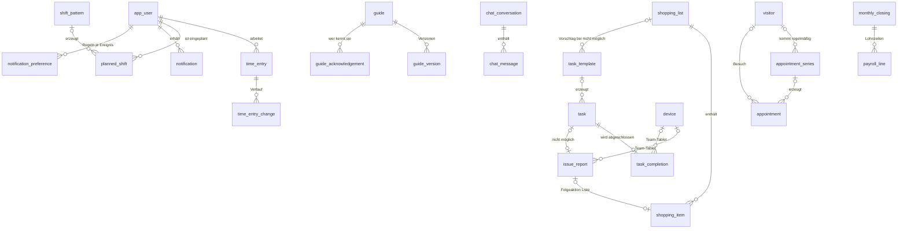

# Konzept 6 – Datenbank (MariaDB 11.8 LTS)

Stand: 04.11.2026 (M7: shopping_item.link, shopping_favorite.link) · Referenzschema: `docs/datenbank/schema.sql` · Test: `docs/datenbank/smoke_test.sql` · App: **HomeCrew**

## 1. Rahmen
- **MariaDB 11.8 LTS** (geklärt 01.11. abends, vorher 11.4 LTS), InnoDB, `utf8mb4_unicode_ci`. Lokal 11.8.6; der Pi nutzt dieselbe Version.
- **Eine Datenbank = ein Haushalt** – keine Mandantenspalten (geklärt).
- **78 Tabellen**, 155 Fremdschlüssel, 159 CHECK-Constraints (gegen MariaDB 11.8.6 geprüft, Stand M7). MariaDB legt für die drei JSON-Spalten zusätzlich je einen automatischen `json_valid`-CHECK an – `information_schema` zeigt deshalb 162.
- Doctrine-Migrations erzeugen das Schema (Strategie in §6); `schema.sql` bleibt die fachliche Referenz.

## 2. Konventionen
| Thema | Regel |
|---|---|
| Namen | Tabellen/Spalten englisch, snake_case; Wertelisten deutsch |
| Schlüssel | `BIGINT UNSIGNED AUTO_INCREMENT`; nach außen sichtbare Objekte zusätzlich `public_id BINARY(16)` (UUID v7) |
| Zeit | Zeitpunkte in **UTC** (technische Zeitstempel, Stempelzeiten); **Geplantes** in Ortszeit |
| Zahlen | Geld `DECIMAL(10,2)`, Prozentsätze `DECIMAL(6,3)`, Dauern in Minuten |
| Wertelisten | `VARCHAR` + `CHECK` (PHP-Backed-Enums) |
| Verschlüsselung | Spalten `*_enc` = libsodium-Chiffrat (u. a. KI-Schlüssel, SMTP-Passwort) |
| NULL in CHECKs | Optionale Spalten immer mit `IS [NOT] NULL`; keine CHECKs auf Spalten mit `ON DELETE SET NULL` |
| Serien | Vorlage + erzeugte Vorkommen mit **Ursprungstag** (eindeutig je Vorlage und Tag) und `is_modified` – gleiches Muster bei Wartungsplänen, Dienstplan und Termin-/Besuchsserien |

## 3. Tabellen nach Bereichen

| Bereich | Tabellen | Stufe |
|---|---|---|
| Einstellungen & Erweiterungen | `app_setting` (genau eine Zeile – inkl. KI-Schlüssel, SMTP-Zugang, Status, Funktionsschalter) | 1 |
| Personen, Anmeldung, Geräte | `app_user`, `webauthn_credential`, `password_reset_request`, `invitation`, `device` | 1 |
| Alltag | `task_template`, `task_template_item`, `task`, `task_item`, `task_completion`, `task_item_result`, `handover_note`, `handover_read` | 1 |
| Kalender: Termine & Besuche | `visitor` (externe Dienste), `appointment_series`, `appointment`, `appointment_participant`, `appointment_item` | 1 |
| Listen | `shopping_list`, `shopping_item`, `shopping_favorite` | 1 |
| Meldungen | `issue_report` | 1 |
| Dienstplan & Zeiten | `shift_pattern`, `planned_shift`, `time_entry`, `time_entry_change`, `manager_absence` | 1 |
| Wissen & Notfall | `guide`, `guide_version`, `guide_step`, `guide_step_media`, `guide_tag`, `guide_feedback`, `guide_acknowledgement`, `recipe_ingredient`, `emergency_contact` | 1 |
| Orte, Profil | `poi`, `poi_guide`, `profile_item`, `profile_keyword` | 1 |
| Medien | `media`, `upload_session` | 1 |
| Benachrichtigungen, Protokoll | `notification`, `notification_preference`, `audit_log` | 1 |
| Nachrichten | `chat_conversation`, `chat_message`, `chat_participant` | 2 |
| Hilfsmittel & Wartung | `asset`, `asset_component`, `asset_component_property`, `asset_guide`, `component_measurement` | 2 (Tabellen schon in 1) |
| KI-Assistent | `ai_conversation`, `ai_message`, `ai_action`, `ai_usage_month` | 2 |
| Personal & Abrechnung | `employee_record`, `wage_rate`, `vacation_entitlement`, `absence`, `sick_pay_refund`, `monthly_closing`, `timesheet_confirmation`, `payroll_line`, `funding_grant`, `reminder` | 3 (Urlaubsantrag/Krank schon in 1) |
| Checklisten | `checklist_template`, `checklist_template_item`, `checklist`, `checklist_item` | 3 |
| Global | `legal_limit`, `contribution_rate` | 3 |
| Push, Kalender-Abo | `push_subscription`, `calendar_feed` | 4 |
| Übersetzung | `guide_translation`, `guide_step_translation` | 5 |

**Entfallen** (geklärt): Mandanten, Lernpfade, Schlüsselliste (zurückgestellt), gemeinsamer Entsperr-Code am Tablet, `task_completion.follow_up` (→ Meldung).

## 4. Kern-Beziehungen



## 5. Wichtige Entscheidungen
1. **`app_user` = Person im Haushalt** inkl. Anmeldung (Passwort/Passkey/2FA und/oder Tablet-PIN) und persönlicher Einstellungen. Benutzername vom Admin, eindeutig; Anzeigename eindeutig. Personen ohne jeden Zugang (nur Team-Tablet) sind erlaubt. **Externe Dienste sind keine `app_user`**, sondern `visitor`.
2. **Rolle + Admin-Recht**: `role` (manager/assistenz/angehoerige), `is_admin`. CHECKs: Manager ist immer Admin, Assistenz nie Admin; **genau ein Manager** (generierte Spalte + eindeutiger Index). 2FA-Pflicht für Admins setzt die App beim Login durch.
3. **PIN** pro Person, Standard aus; nur mit gesetzter PIN aktivierbar; Start-PIN muss geändert werden; `app_setting.pin_lan_only`.
4. **Gerätemodus** (`device.mode`): `team` (Standard) · `persoenlich` · `beides`; Bildschirmschoner (`dim_after_seconds`); Schriftgröße am Gerät (`device.font_size`, Werte wie `app_user.font_size`, ergänzt 01.11. für M2). Kein eigener Entsperr-Code.
5. **Absender Gerät statt Person**: `task_completion`, `task` (Weitergeben: `assigned_by_device_id`, ergänzt in M5), `issue_report`, `handover_note`, `shopping_item`, `media` und `audit_log` haben eine Geräte-Spalte (ON DELETE SET NULL).
6. **Erweiterungen in `app_setting`**: KI (`ai_enabled`, Anbieter, Modell, `ai_api_key_enc` + `ai_api_key_hint`, `ai_key_status` fehlt/ungeprueft/ok/fehler, Prüfzeitpunkt, Fehlermeldung, Funktionsschalter Assistent/Schreibhilfe/Übersetzung/Team-Tablet, Monatsbudget) und E-Mail (`mail_enabled`, SMTP-Server/Port/Verschlüsselung/Benutzer, `smtp_password_enc`, Absender, `mail_status`). CHECKs: **KI nur mit Schlüssel einschaltbar**; Status „fehlt" genau dann, wenn kein Schlüssel; **E-Mail nur mit Server, Port und Absender einschaltbar**. Ob eine Funktion sichtbar ist, entscheidet die App zur Laufzeit (`FeatureAvailability`: Schalter + Status ok + Budget + Personenrecht).
7. **Besuche & Serien**: `appointment.kind` = `termin` · `besuch`. Besuche haben weder Begleitung noch Zuständigkeits-Rolle (CHECK, auch an der Serie); Standard-Sichtbarkeit `alle`. `appointment_series` erzeugt Vorkommen mit `occurrence_date` (eindeutig je Serie) und `is_modified`; `status = abgesagt` mit `cancel_note`. Serie löschen entfernt ihre Vorkommen (CASCADE).
8. **Meldungen** (`issue_report`): genau eine je Aufgabe bei „nicht möglich" oder über „Melden"; Status mit Abschluss-CHECKs; Folgeaktion mit Verweis; automatischer Abschluss durch die App; „auch bemerkt".
9. **Benachrichtigungsregeln** (`notification_preference`): je Person und Ereignis App/E-Mail/Push; nur Abweichungen von den Standards je Rolle.
10. **„Zuletzt erledigt"**: für alle nur das Datum; Admins sehen zusätzlich Person bzw. Gerät.
11. **Zeitänderungen**: `time_entry_change` protokolliert jede Änderung; `selbst` ohne, `admin`/`nachtrag` mit Begründung (CHECK). „Dienstplan übernehmen" → `start_source = 'dienstplan'`.
12. **Zuständigkeit & Weitergeben** an Aufgaben, Terminen und Checklisten-Punkten; `assigned_by_user_id`/`assigned_at`.
13. **Sichtbarkeit** einheitlich: `alle` · `zustaendig` · `admins` · `privat`; Meldungen `alle` · `admins`. Das Team-Tablet sieht, was die Rolle Assistenz sähe.
14. **Mehrere Listen**; Listeneinträge mit Quelle (`manuell`, `aufgabe`, `rezept`, `ki`, `meldung`).
15. **Notfallkontakte**, **Wer kennt welche Anleitung**, ein offener Dienst je Person, versionierte Anleitungen, bezahlte Ausfälle mit Rechen-CHECKs, Medien mit genau einem Besitzer, ein Team-Chat, ein Direktchat je Paar.
16. **Datenschutz in der Struktur**: keine Diagnosen, Medikamente, Adressen, SV-/Steuernummern; externe Dienste ohne Klarnamen; Geheimnisse nur verschlüsselt; Löschdaten an allen kurzlebigen Inhalten.

## 6. Doctrine und Migrationsstrategie

### 6.1 Migrationsstrategie (in M1 erprobt, gilt für alle Meilensteine)
1. Tabellen entstehen immer **vollständig** nach `schema.sql` (alle Spalten, Indizes, Fremdschlüssel, CHECKs, generierten Spalten, Tabellenkommentar) – keine halben Tabellen.
2. Eine Tabelle entsteht in dem Meilenstein, der sie braucht, **zusammen mit allen Tabellen, auf die sie per Fremdschlüssel verweist** (transitiv); solche Tabellen bekommen Entity + Migration, aber noch keine Oberfläche.
3. Je Meilenstein eine Migration (bei Bedarf wenige thematische). Die `CREATE TABLE`-Anweisungen werden **wörtlich aus `schema.sql` übernommen** (ohne SQL-Kommentare): Doctrine kennt weder CHECKs noch generierte Spalten noch `ON UPDATE` und schreibt Bool-Spalten als `TINYINT` statt `TINYINT(1)`. `doctrine:migrations:diff` dient vorher als Hilfe und danach als **Gegenprobe – es muss „No changes detected" melden**. Startdaten (z. B. `INSERT INTO app_setting (id) VALUES (1)`) stehen in derselben Migration. `isTransactional()` liefert `false` (MariaDB schreibt DDL sofort fest). Nie `DROP` für noch nicht gemappte Tabellen/Spalten; nie `doctrine:schema:update`.
4. **Invariante**: Jede migrierte Tabelle ist identisch mit derselben Tabelle der Referenz. `composer schema:check` (Befehl `app:schema:check`, nur dev) legt `homecrew_smoke` neu an und lädt `schema.sql`, legt `homecrew_check` neu an und migriert von Null, und vergleicht über `information_schema`: Spalten (Position, Typ, NULL, Default, Extra inkl. `ON UPDATE`, generierter Ausdruck, Kollation, Kommentar), Indizes, Fremdschlüssel (inkl. ON DELETE/UPDATE), CHECKs, Engine, Kollation und Tabellenkommentar. Muss am Ende jedes Meilensteins grün sein.
5. **Technische Tabellen** außerhalb der Referenz: `doctrine_migration_versions`, ab M11 `messenger_messages`. Der Abgleich überspringt sie.
6. Fachliche Schemaänderung → zuerst `schema.sql` + `smoke_test.sql`, Smoke-Test grün, dann Migration.

### 6.2 Mapping ohne Scheinänderungen
Ziel: `doctrine:schema:validate` meldet „in sync", ein zweites `migrations:diff` erzeugt nichts. Spaltennamen immer mit `name:` angeben, Properties in der Reihenfolge des Schemas.

| Referenz | Mapping | Warum |
|---|---|---|
| `TINYINT(1)` | `bool`, Typ `boolean` | – |
| `TINYINT [UNSIGNED]` | eigener Typ `tinyint` (`App\Doctrine\Type\TinyIntType`), ggf. `unsigned` | DBAL liest jede TINYINT-Spalte als bool. `App\Doctrine\Schema\MariaDbSchemaManager` (über `schema_manager_factory`) liest nur `tinyint(1)` als bool |
| `SMALLINT UNSIGNED`, `BIGINT UNSIGNED` | `Types::SMALLINT`/`Types::BIGINT`, `unsigned` | – |
| `CHAR(n)` | `length: n`, `options: ['fixed' => true]` | – |
| `BINARY(16)` (`public_id`) | `UuidType::NAME` (Symfony Uid, `Uuid::v7()`) | Auf MariaDB als `BINARY(16)`, kein nativer UUID-Typ |
| `VARBINARY(n)` (`*_enc`) | `Types::BINARY`, `length: n`, `?string` | – |
| `JSON` | `Types::JSON` | MariaDB: `LONGTEXT` + automatischer `json_valid`-CHECK; DBAL erkennt das |
| `DECIMAL(p,s)`, `TIME`, `DATE`, `DATETIME` | `Types::DECIMAL` (`?string`), `*_IMMUTABLE` | Geld nie als float |
| `TEXT` | `Types::TEXT`, `length: 65535` | ohne Länge macht DBAL daraus `LONGTEXT` (M4) |
| `DEFAULT CURRENT_TIMESTAMP [ON UPDATE …]` | nur lesend: `insertable/updatable: false`, `generated: 'INSERT'` bzw. `'ALWAYS'`, `options: ['default' => new CurrentTimestamp()]`, bei `ON UPDATE` zusätzlich `columnDefinition` | Die Datenbank setzt die Zeit (UTC), Doctrine liest sie nach dem Speichern |
| Generierte Spalte (`… AS (…) STORED`) | gemappt, nur lesend (`generated: 'ALWAYS'`, `columnDefinition` mit Ausdruck) | **Nicht weglassen** – ungemappt würde `diff` sie löschen wollen |
| CHECK-Constraints | nicht im Mapping | nur in der Migration; Doctrine ignoriert sie |
| Indizes | `#[ORM\Index]`/`#[ORM\UniqueConstraint]` mit dem Namen aus der Referenz; nie `unique: true` an der Spalte | – |
| Tabellenkommentar | `#[ORM\Table(options: ['comment' => …])]` | Spaltenkommentare gibt es nicht (`--` in `schema.sql` sind SQL-Kommentare) |

Verbindung: `SET time_zone = '+00:00'` per `Pdo\Mysql::ATTR_INIT_COMMAND`, Tabellenoptionen `utf8mb4_unicode_ci` (`config/packages/doctrine.yaml`).

**Achtung DBAL 5:** DBAL 4.5 hat zusätzlich einen neuen Introspektionsweg (`MetadataProvider`, z. B. `introspectTableColumns()`), der `TINYINT UNSIGNED` weiterhin als bool liest. Doctrine ORM und Migrations nutzen für den Abgleich noch `introspectSchema()`. Beim Umstieg auf DBAL 5 die TINYINT-Lösung anpassen – der Test `MappingTest::testMappingMatchesTheMigratedSchema` schlägt dann an.

### 6.3 Weitere Hinweise
- Generierte Spalten nur lesend mappen (siehe 6.2).
- `app_user` als Symfony-User-Entity (Benutzername als Identifier); PIN-Anmeldung als eigener Authenticator, nur für gekoppelte Geräte im Heimnetz.
- **Team-Tablet** als eigener Security-Kontext: Geräte-Token (Cookie) → „Geräte-Benutzer" mit Rolle `ROLE_TEAM_DEVICE`, kein `app_user`.
- **Erweiterungen**: `*_enc`-Felder nie in Formulare zurückschreiben (nur „neu setzen"/„löschen"); Mailer-DSN und KI-Client zur Laufzeit aus `app_setting` bauen, Umgebungsvariablen haben Vorrang.
- **Meldungen**: Abschluss über Doctrine-Events bzw. Messenger.
- **Serien** (Termine/Besuche, Wartungspläne, Dienstplan): ein gemeinsamer Generator-Dienst auf Basis von php-rrule, per Scheduler täglich; überspringt `is_modified`.

## 7. Löschjobs
Übergaben · Erledigungen · Meldungen · Nachrichten (365 Tage) · Benachrichtigungen · KI-Gespräche · Reset-Links/2FA-Codes · Push-Abos · Uploads · Audit-Log · Personaldaten erst nach gesetzter Frist. Vergangene Termine/Besuche: vorerst keine automatische Löschung (Frist offen).

## 8. Smoke-Test
Auf einer **leeren** Datenbank (lokal in WSL, der Benutzer meldet sich per `unix_socket` an; auf dem Pi beim Aufbau wiederholen):

```bash
mariadb -e "DROP DATABASE IF EXISTS homecrew_smoke; CREATE DATABASE homecrew_smoke CHARACTER SET utf8mb4 COLLATE utf8mb4_unicode_ci"
mariadb homecrew_smoke < docs/datenbank/schema.sql
mariadb homecrew_smoke < docs/datenbank/smoke_test.sql
```
Erwartet: nur „OK", letzte Zeile **ALLE PRÜFUNGEN OK**. Geprüft werden Positivfälle (Team-Tablet, „Seife leer", Physio-/Caritas-Serien, eingerichtete Erweiterungen), **96 Regeln** (u. a. genau ein Manager, Manager immer Admin, Assistenz nie Admin, Admin-Korrektur nur mit Begründung, Gerätemodi und -schriftgröße, Zeitquellen, Meldungs-Status, Benachrichtigungsregeln, Besuche ohne Begleitung/Zuständigkeit, Serien-Vorkommen eindeutig, **KI nur mit Schlüssel, E-Mail nur mit vollständigem Zugang**) und das Löschverhalten.

**Ergebnis 01.11.2026** (MariaDB 11.8.6, WSL2 Debian): **ALLE PRÜFUNGEN OK** – 7 Positivfälle (A), 92 Regeln (B), 13 Lösch- und Verweisfälle (C); die Referenz musste nicht geändert werden. **Nachtrag M2:** `device.font_size` ergänzt (Regel B93) – wieder ALLE PRÜFUNGEN OK (93 B). **Nachtrag M4:** `emergency_contact.category` von `VARCHAR(12)` auf `VARCHAR(15)` – der eigene CHECK erlaubt `'dienstleister'` (13 Zeichen), das ließ sich bisher nicht speichern; Positivfall im Smoke-Test ergänzt, wieder ALLE PRÜFUNGEN OK. Eine Prüfung aller Wertelisten gegen ihre Spaltenlänge fand nichts weiter. **Nachtrag M5:** `task.assigned_by_device_id` (Weitergeben am Team-Tablet: Gerät statt Person, Entscheidung 03.11.) mit Index und Fremdschlüssel; Positivfall „Weitergabe am Team-Tablet" und C11 „Gerät gelöscht → Erledigung und Weitergabe bleiben" ergänzt – wieder ALLE PRÜFUNGEN OK (8 A, 93 B, 14 C). **Nachtrag M6:** `task.is_modified` (einzeln geänderte Vorkommen eines Wartungsplans, wie bei Terminen und Dienstplan – §2 „Serien" sah es vor, die Spalte fehlte) mit CHECK `ck_task_modified` (nur Vorkommen); Positivfall „verschobenes Vorkommen" und B94 – wieder ALLE PRÜFUNGEN OK (94 B). **Nachtrag M7:** `shopping_item.link` und `shopping_favorite.link` (`VARCHAR(500)`, Link zum Produkt, Wunsch 03.11.) mit CHECK `ck_shopping_link`/`ck_favorite_link` (nur `https://`); Positivfall „Lieblingsartikel mit Link" und B95/B96 – wieder ALLE PRÜFUNGEN OK (96 B). Die Regeln der migrierten Tabellen laufen zusätzlich als PHPUnit-Tests (`tests/Database/`).
